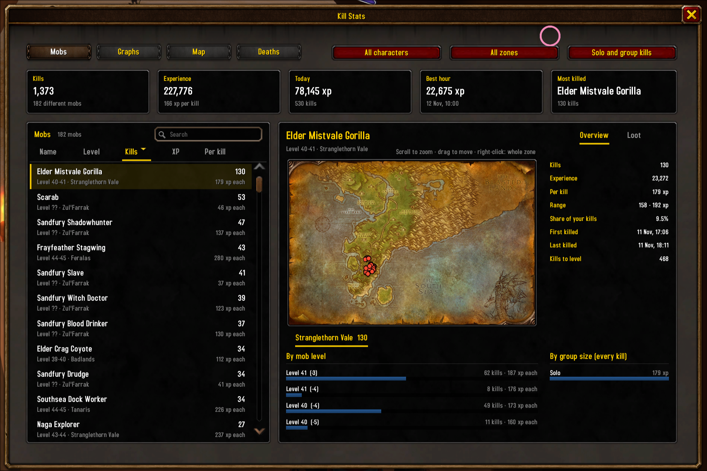
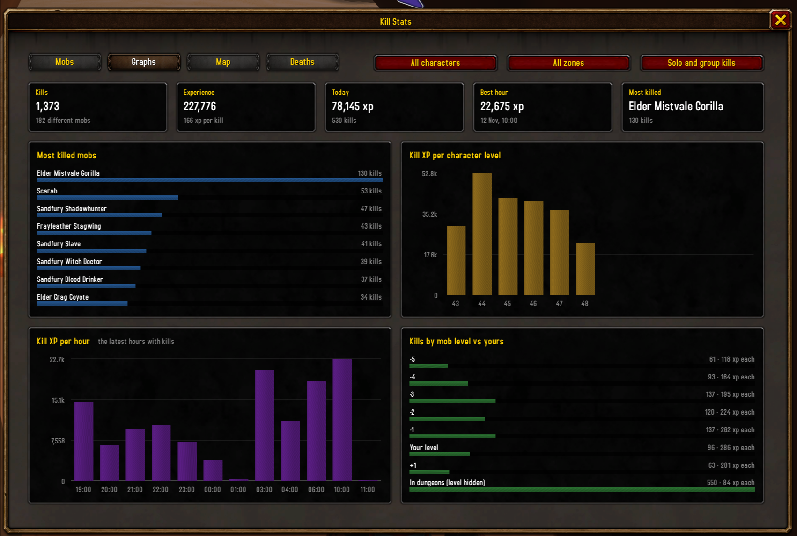
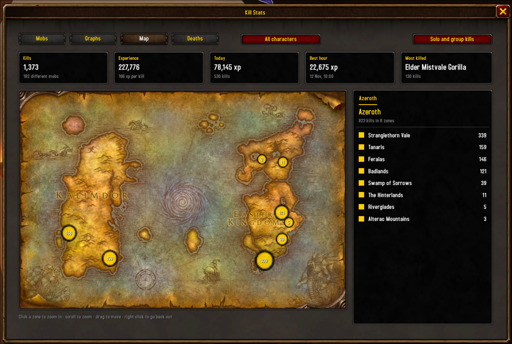
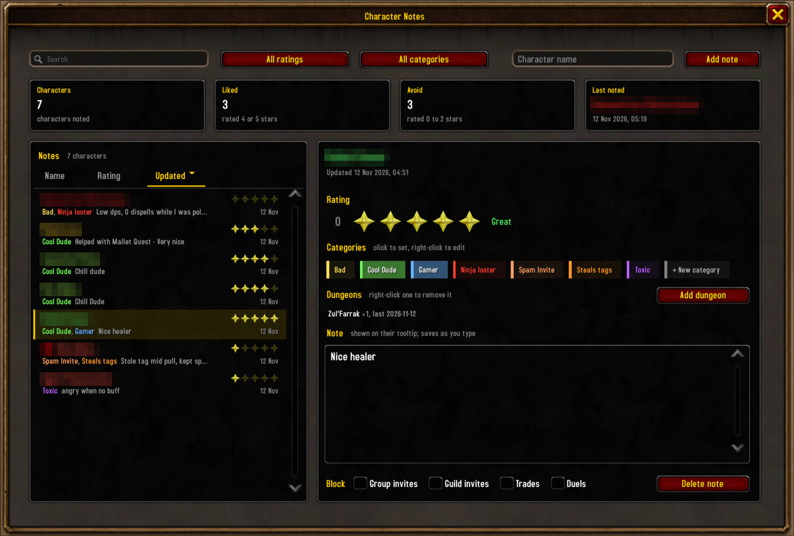
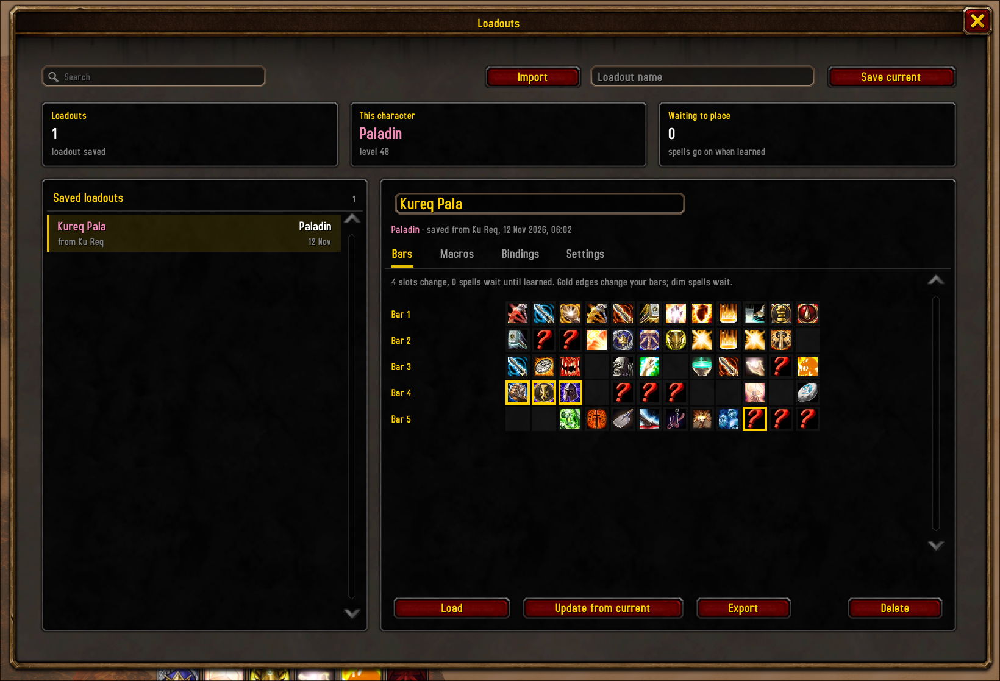

# Kureq Utils

Small quality-of-life utilities for **WoW Forever**: kill stats with graphs and maps,
a delete key for full bags, notes and ratings on other players, loadouts you can move between characters, and a ping
macro with a nearby alert.

Each utility is a module you turn on or off per character on the settings page (`/ku`, or left-click the minimap
button; right-click it for a menu of the windows). Turning a module off never deletes its data.

- [Install](#install)
- [Kill stats](#kill-stats)
- [Delete items](#delete-items)
- [Character notes](#character-notes)
- [Loadouts](#loadouts)
- [Ping macro and nearby alert](#ping-macro-and-nearby-alert)
- [Commands](#commands)
- [Saved data](#saved-data)

## Install

- **Wago or CurseForge:** install it with your addon client.
- **By hand:** download the latest zip from [Releases](https://github.com/viktorbergqvist/kureq_utils/releases) and
  unzip it into `World of Warcraft/_forever_/Interface/AddOns/`, so you get
  `Interface/AddOns/KureqUtils/KureqUtils.toc`. Restart the game.

Then type `/ku` to see the modules and their settings.

## Kill stats

Every mob you kill for experience is recorded: who, where, at what level, for how much XP, solo or in a group. Open
the window with `/ku stats`. The tiles on top always show your totals: kills, experience, today, your best hour and
your most killed mob. The menus in the top right pick one character or all of them added together, one zone or all,
and solo, group or all kills.

### Mobs

Every mob you've killed, sortable by name, level, kills, total XP or XP per kill, with a search box. Pick one to see
where you killed it on the zone map (scroll to zoom, drag to move, right-click for the whole zone), its XP range,
your share of kills, first and last kill, and **kills to level**: how many more of it take you to your next level.
Below the map, its kills are broken down by mob level and by group size. The **Loot** tab shows what it dropped and
how often, if loot tracking is on.

### Graphs

- **Most killed mobs.**
- **Kill XP per character level:** where your kill experience came from as you leveled.
- **Kill XP per hour:** your latest hours with kills, to see how fast you're going.
- **Kills by mob level vs yours:** XP per kill at each level difference, so you can see which mobs are worth it.
  Kills inside dungeons, where the game hides mob levels, get their own row.

### Map

Your kills on the world map, one marker per zone sized by kill count. Click a zone to zoom in to where each kill
happened, scroll to zoom, drag to move, and right-click to go back out. The list on the right ranks the zones.

### Deaths

Every death, with what killed you. With **Show a recap when you die** on, a small window shows the last hits you
took: damage by school and by source.

### On tooltips

- **Kill XP:** a mob's tooltip shows your average XP from it at the same level difference and group size.
- **Kills to level:** how many more of that mob take you to your next level.
- **Drop chances:** with **Track loot** on, what it drops, counted per corpse.

**Settings** (`/ku stats settings`): Show kill XP on mob tooltips, Print each kill to chat, Show a recap when you
die, Show kills to level, Track loot, and buttons to clear loot data or all kill stats.

## Delete items

Bags full in the middle of a quest? Press one key and the cheapest item you allow is deleted. Bind it in **Key
Bindings > AddOns > Kureq Utils**, or type `/ku delete`.

You decide what may go:

- **Highest quality:** Poor, Common or Uncommon. Anything better is kept.
- **Max stack value:** the most a deleted stack may be worth at a vendor, such as `50s` or `1g 20s`.
- **Keep quest items**, **Keep weapons and armor**, **Delete unsellable items**.
- **Never delete** and **Allow delete** lists: drop items on them, or add name rules (starts with, ends with,
  contains, or a Lua pattern). Never always wins; your Hearthstone is on it from the start.
- **Press twice to delete:** the first press says in chat what would go, such as `press again to delete [Ruined
  Pelt] x3, worth 45c`; press again within 10 seconds to delete it.

The settings page always shows what's **next to delete**. When looting fails because your bags are full, chat says
which item the key would remove, and the loot window marks loot worth more at a vendor than that item.

**Deletion statistics** in the settings show what you've deleted, per character: totals, and a searchable table of
items with count and value that you sort by clicking the column headers.

## Character notes

Give anyone a star rating from 0 to 5 and a note. Right-click a player (in the world, chat or your group) and
choose **Add note**, or type `/ku note` for your target, or `/ku note Name`. All notes are in the notes window
(`/ku notes`): search, filter by rating or category, and sort by name, rating or last updated. The tiles count how many
you've noted, liked (4 or 5 stars) and want to avoid (0 to 2 stars).

- **Categories:** tag people with your own colored categories ("Cool Dude", "Ninja looter", "Steals tags"…). Click
  one to set it, right-click to edit it, or make a new one.
- **On tooltips:** their stars and note.
- **In the Looking For Group window:** your stars and note next to the people listed, before you join.
- **Dungeons together:** the dungeons you ran with them, how many times and when last, recorded on their note by
  itself (or added by hand).
- **Warnings:** a chat line and the raid warning sound when someone you rated 2 stars or less, or blocked, joins your
  group or whispers you.
- **Block:** from the right-click menu, block their group invites, guild invites, trades and duels, each on its own.
  They're declined for you, with a chat line if you want one.

## Loadouts

Save your action bars, macros, key bindings and settings as a named loadout, and load it on any character
(`/ku loadouts`).

- **Preview:** see a loadout's bars as icons before loading. Slots that would change are marked, and spells you
  don't know yet are dimmed (they're placed once you learn them).
- **Load only parts:** pick Bars, Macros, Bindings and Settings in the load confirmation.
- **Undo:** each load first saves your current setup as a backup ("Before <name>", the last 5 per character); Restore
  puts back what that load changed.
- **Share:** Export gives one line of text to copy; paste it into Import to make a copy. Imported macros can contain
  `/run` commands, so read them in the Macros tab before loading.

Loading never happens in combat.

## Ping macro and nearby alert

Kureq Utils keeps a macro, **KureqPingCustom**, that targets a mob and pings it. Put it on your action bar, then:

- `/ku ping Defias Pillager` makes it target that mob.
- `/ku ping` with a quest link, or **Alt-click** a quest in the quest log or Questie's tracker, makes it target that
  quest's mobs (needs Questie).

The macro only rewrites itself out of combat, and only acts when you press it. In the settings you choose the
targeting command (`/TargetExact` or `/target`), an optional raid marker, an action line, and whether dead targets
are cleared.

**Nearby alert** shows a message, with the raid warning sound if you want, when a mob you're after shows up on your
nameplates. Enemy nameplates must be on (V).

## Commands

| Command | What it does |
|---|---|
| `/ku` | Settings |
| `/ku stats` | Kill stats window (`/ku stats settings` for its settings) |
| `/ku delete` | Delete the cheapest allowed bag item now |
| `/ku note [name]` | Your target's note, or that character's |
| `/ku notes` | Notes window |
| `/ku loadouts` | Loadouts window |
| `/ku ping <name or quest link>` | What the ping macro targets |

## Saved data

Kill stats, notes, deletion statistics, loadouts and loadout backups are saved account-wide in `KureqUtilsDB`, so
every character can see them. Which modules are on is saved per character in `KureqUtilsCharDB`.

## Changelog and licence

See [CHANGELOG.md](https://github.com/viktorbergqvist/kureq_utils/blob/main/CHANGELOG.md). Licensed under GPL-3.0, see [LICENSE](https://github.com/viktorbergqvist/kureq_utils/blob/main/LICENSE).
