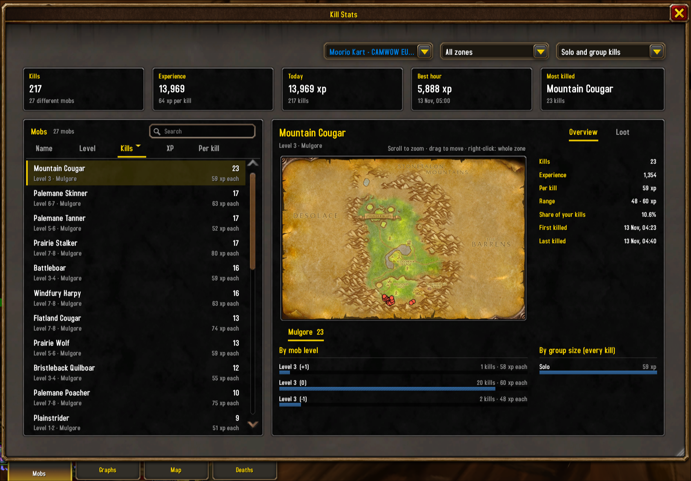
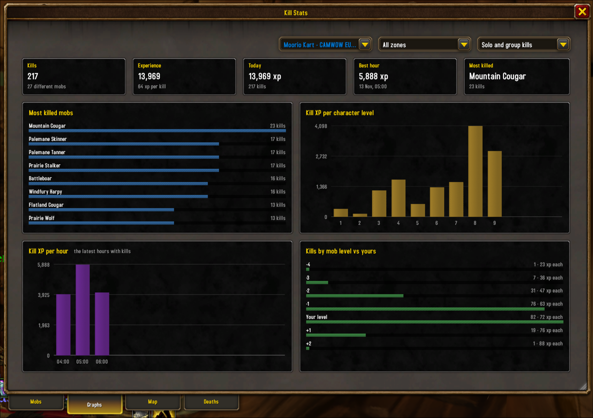
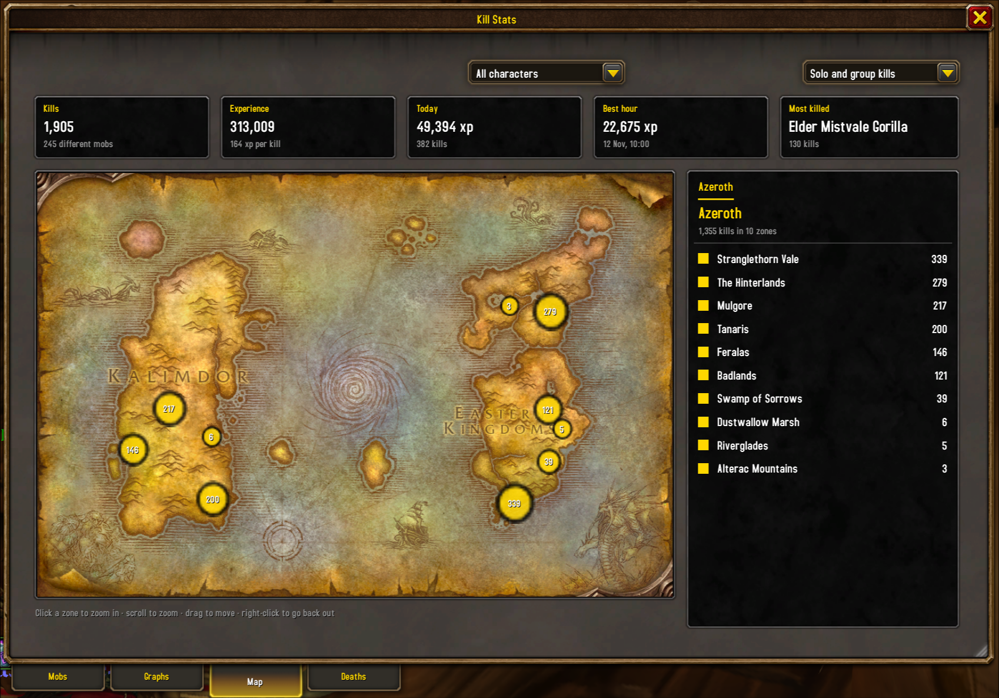
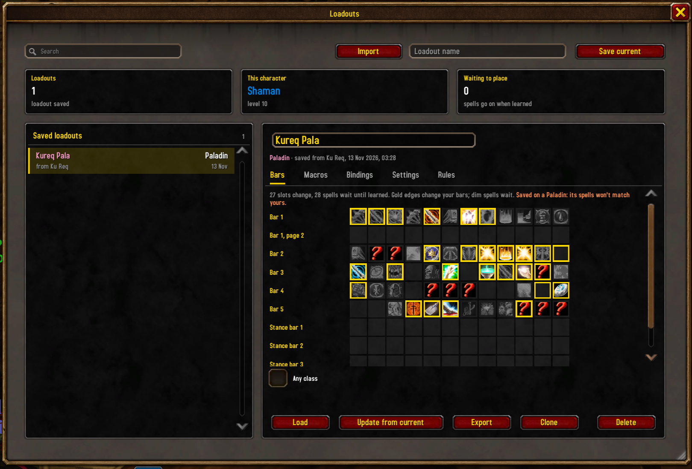
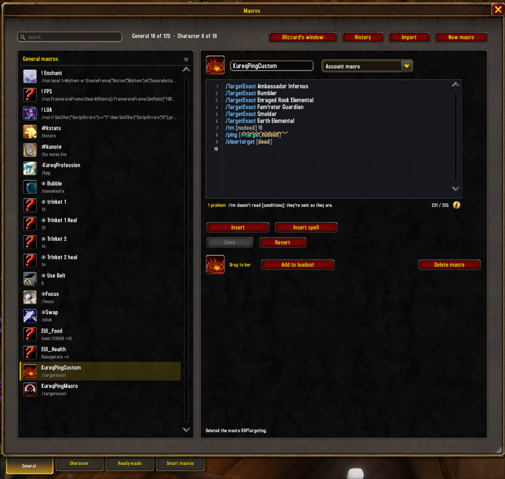
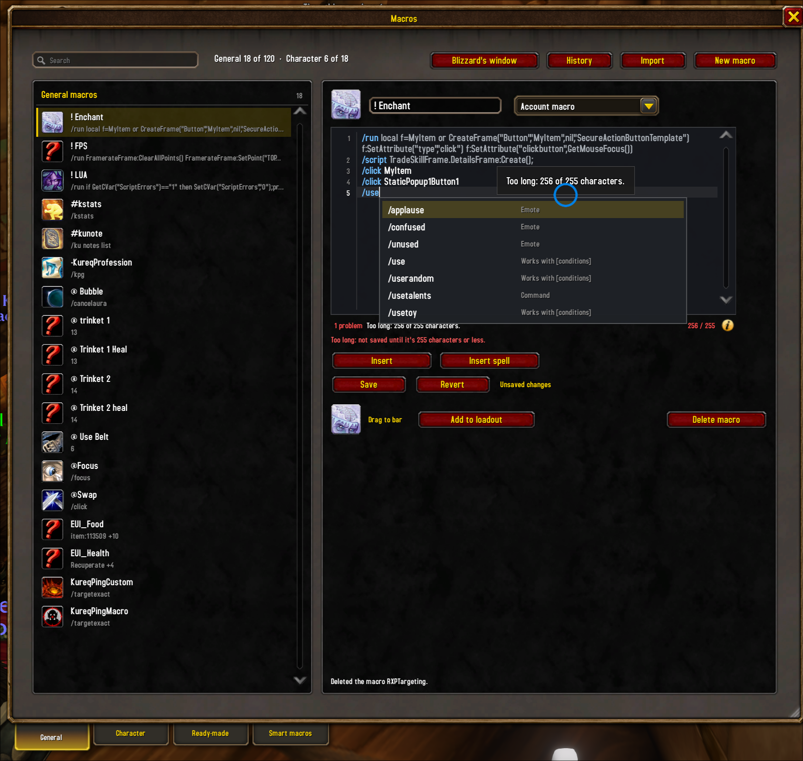
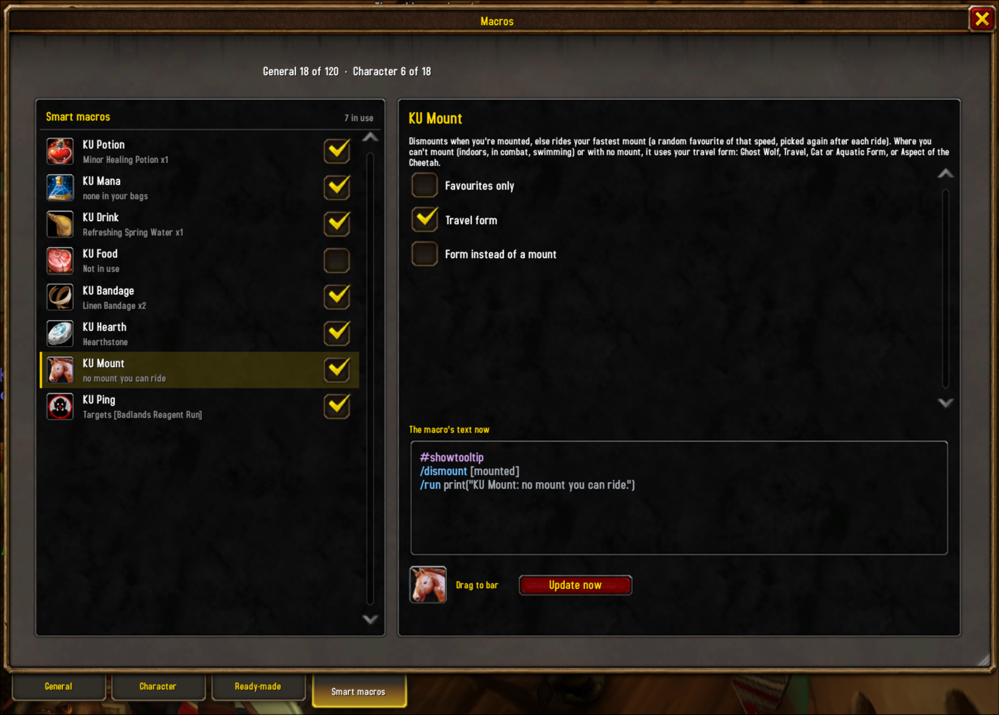
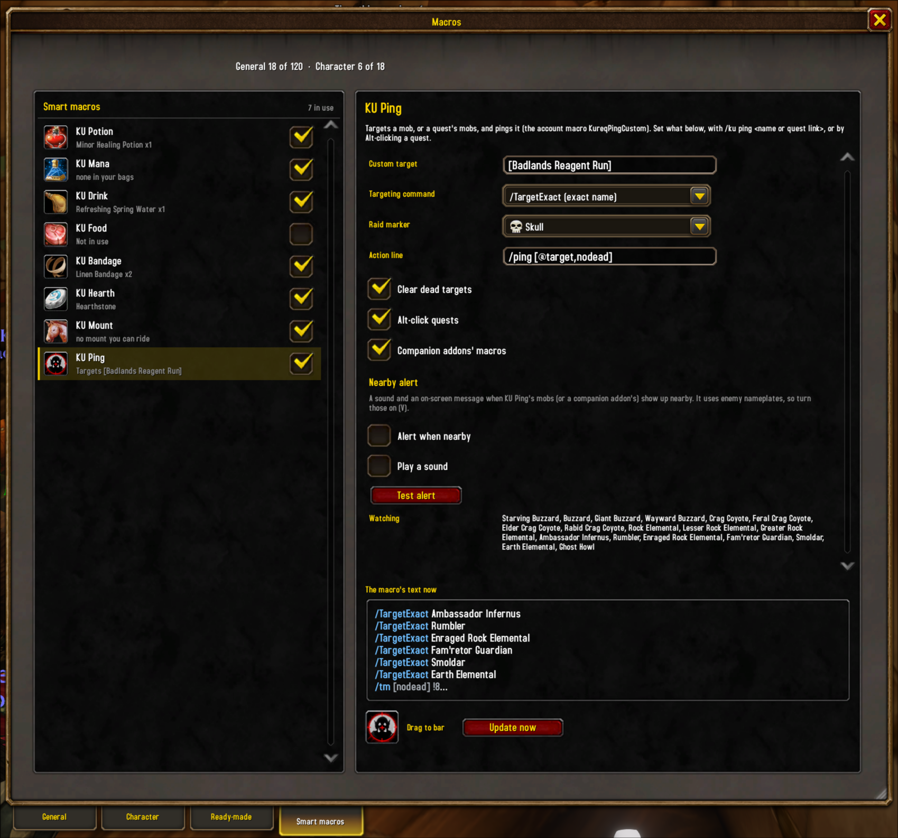
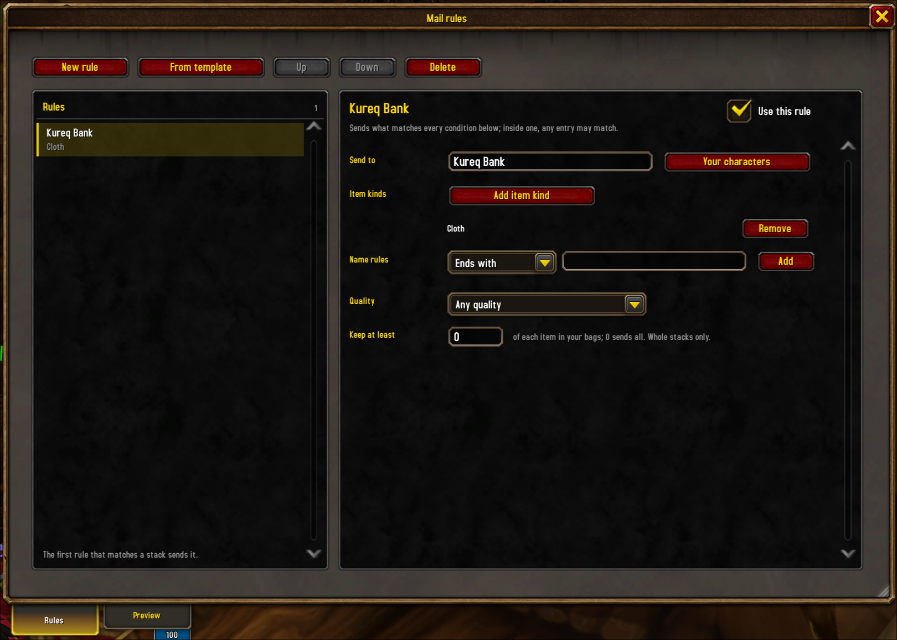

# Kureq Utils

Small quality-of-life utilities for **WoW Forever**: kill stats with graphs and maps,
a delete key for full bags, notes and ratings on other players, loadouts you can move between characters, a macro
maker with ready-made and smart macros (a ping macro with a nearby alert among them), and mail rules that send your mats to
your other characters.

Each utility is a module you turn on or off per character on the settings page (`/ku`, or left-click the minimap
button; right-click it for a menu of the windows). Turning a module off never deletes its data. Each window and the
settings page can also open from a key: bind them in **Key Bindings > AddOns > Kureq Utils**.

- [Install](#install)
- [Kill stats](#kill-stats)
- [Delete items](#delete-items)
- [Character notes](#character-notes)
- [Loadouts](#loadouts)
- [Macros](#macros)
  - [KU Ping and nearby alert](#ku-ping-and-nearby-alert)
- [Mail rules](#mail-rules)
- [Commands](#commands)
- [Saved data](#saved-data)

## Install

- **Wago or CurseForge:** install it with your addon client.
- **By hand:** download the latest zip from [Releases](https://github.com/viktorbergqvist/kureq_utils/releases) and
  unzip it into `World of Warcraft/_forever_/Interface/AddOns/`, so you get
  `Interface/AddOns/KureqUtils/KureqUtils.toc`. Restart the game.

Then type `/ku` to see the modules and their settings.

## Kill stats

Every mob you kill for experience is recorded: who, where, at what level, for how much XP, solo or in a group. Open
the window with `/ku stats`. The tiles on top always show your totals: kills, experience, today, your best hour and
your most killed mob. The menus in the top right pick one character or all of them added together, one zone or all,
and solo, group or all kills.

### Mobs

Every mob you've killed, sortable by name, level, kills, total XP or XP per kill, with a search box. Pick one to see
where you killed it on the zone map (scroll to zoom, drag to move, right-click for the whole zone), its XP range,
your share of kills, first and last kill, and **kills to level**: how many more of it take you to your next level.
Below the map, its kills are broken down by mob level and by group size. The **Loot** tab shows what it dropped and
how often, if loot tracking is on.

### Graphs

- **Most killed mobs.**
- **Kill XP per character level:** where your kill experience came from as you leveled.
- **Kill XP per hour:** your latest hours with kills, to see how fast you're going.
- **Kills by mob level vs yours:** XP per kill at each level difference, so you can see which mobs are worth it.
  Kills inside dungeons, where the game hides mob levels, get their own row.

### Map

Your kills on the world map, one marker per zone sized by kill count. Click a zone to zoom in to where each kill
happened, scroll to zoom, drag to move, and right-click to go back out. The list on the right ranks the zones.

### Deaths

Every death, with what killed you. With **Show a recap when you die** on, a small window shows the last hits you
took: damage by school and by source.

### On tooltips

- **Kill XP:** a mob's tooltip shows your average XP from it at the same level difference and group size.
- **Kills to level:** how many more of that mob take you to your next level.
- **Drop chances:** with **Track loot** on, what it drops, counted per corpse.

**Settings** (`/ku stats settings`): Show kill XP on mob tooltips, Print each kill to chat, Show a recap when you
die, Show kills to level, Track loot, and buttons to clear loot data or all kill stats.

## Delete items

Bags full in the middle of a quest? Press one key and the cheapest item you allow is deleted. Bind it in **Key
Bindings > AddOns > Kureq Utils**, or type `/ku delete`.

You decide what may go:

- **Highest quality:** Poor, Common or Uncommon. Anything better is kept.
- **Max stack value:** the most a deleted stack may be worth at a vendor, such as `50s` or `1g 20s`.
- **Keep quest items**, **Keep weapons and armor**, **Delete unsellable items**.
- **Never delete** and **Allow delete** lists: drop items on them, or add name rules (starts with, ends with,
  contains, or a Lua pattern). Never always wins; your Hearthstone is on it from the start.
- **Press twice to delete:** the first press says in chat what would go, such as `press again to delete [Ruined
  Pelt] x3, worth 45c`; press again within 10 seconds to delete it.

For warlocks and hunters, **Class bags** (all off to start):

- **Keep at most this many Soul Shards:** while you carry more, the key deletes one extra shard first.
- **Look in special bags:** quivers, ammo pouches and soul bags are left alone unless this is ticked. Profession
  bags always are.
- **Delete old ammo:** ammo of a lower item level than the ammo you have equipped goes before the cheapest item.
- **Keep at most this many ammo stacks:** extra stacks of ammo you don't have equipped go first, cheapest first.

The key takes an extra Soul Shard first, then old ammo, then an extra ammo stack, then the cheapest item, and chat
says why (`deleted [Soul Shard] x1 (extra Soul Shard)`). Never delete still wins. The shard and ammo options look in quivers, ammo
pouches and soul bags even with Look in special bags off, since that's where shards and ammo live; the reagent bag
only when Look in the reagent bag is ticked.

The settings page always shows what's **next to delete**. When looting fails because your bags are full, chat says
which item the key would remove, and the loot window marks loot worth more at a vendor than that item.

**Deletion statistics** in the settings show what you've deleted, per character: totals, and a searchable table of
items with count and value that you sort by clicking the column headers.

## Character notes

Give anyone a star rating from 0 to 5 and a note. Right-click a player (in the world, chat or your group) and
choose **Add note**, or type `/ku note` for your target, or `/ku note Name`. All notes are in the notes window
(`/ku notes`): search, filter by rating or category, and sort by name, rating or last updated. The tiles count how many
you've noted, liked (4 or 5 stars) and want to avoid (0 to 2 stars).

- **Categories:** tag people with your own colored categories ("Cool Dude", "Ninja looter", "Steals tags"…). Click
  one to set it, right-click to edit it, or make a new one.
- **On tooltips:** their stars and note.
- **In the Looking For Group window:** your stars and note next to the people listed, before you join.
- **Dungeons together:** the dungeons you ran with them, how many times and when last, recorded on their note by
  itself (or added by hand).
- **Warnings:** a chat line and the raid warning sound when someone you rated 2 stars or less, or blocked, joins your
  group or whispers you.
- **Block:** from the right-click menu, block their group invites, guild invites, trades and duels, each on its own.
  They're declined for you, with a chat line if you want one.

### Guild notes

Turn on **Share guild notes** on the Character notes settings page (it's off until you do) to share your notes with
everyone in your guild who has Kureq Utils, and see theirs.

- **What's shared:** stars, note text and categories. Dungeons together and blocks stay on your client.
- **Private:** tick **Private** on a note to keep it to yourself. Deleting a note, or making it Private, removes it
  for the guild too.
- **One note per guildmate:** each guildmate's note sits beside yours, labelled with who wrote it; nobody can change
  anyone else's. Notes are passed along by anyone who has them, so they reach you even when their author is offline;
  those are marked "passed along" until the author sends them.
- **Where they show:** the notes window (All / My / Guild notes; a player's Guild notes tab), tooltips ("Guild: 2 notes,
  3.5 stars" and the newest note), the Looking For Group window (the guild's average when you haven't rated them) and
  warnings (when you haven't rated them and the guild's average is 2 stars or less).
- **Clear guild notes** removes every note you didn't write, for good: only notes written or changed after you
  cleared them come in again.

## Loadouts

Save your action bars, macros, key bindings and settings as a named loadout, and load it on any character
(`/ku loadouts`).

- **Preview:** see a loadout's bars as icons before loading. Slots that would change are marked, and spells you
  don't know yet are dimmed (they're placed once you learn them).
- **Load only parts:** pick Bars, Macros, Bindings and Settings in the load confirmation.
- **Undo:** each load first saves your current setup as a backup ("Before <name>", the last 5 per character); Restore
  puts back what that load changed.
- **Share:** Export gives one line of text to copy; paste it into Import to make a copy. Imported macros can contain
  `/run` commands, so read them in the Macros tab before loading. A loadout with account or ready-made macros
  needs this version or later to import, and so does one for any class, with ignored slots or with rules. Shared
  rules come in off; turn on the ones you want.
- **Clone:** make a full copy of a loadout, or of a backup, named "<name> (copy)", to change without touching the
  original (the button, or right-click it in the list). The copy's rules are off until you turn them on.

Loading never happens in combat.

### One loadout for all your characters

- **Any class:** tick it on a loadout to load it on any class without the other-class warning. Spells your class
  doesn't know wait until you learn them, and ones it can't use are left out.
- **Ignored slots:** right-click a slot in the Bars tab and pick **Ignore this slot** (or **Ignore this bar** for all
  12). Loading never touches an ignored slot, so what a character keeps there stays; the preview shows it crossed out.
- **Apply automatically:** in a loadout's Rules tab, **Add rule** to load it by itself:
  - **New character:** a level 1 character's first login. With no XP and nothing Kureq Utils knows about it, it loads
    by itself; otherwise it asks. Once per character.
  - **Every login:** each time you log in (not on `/reload`), when loading would change something.
  - **Reaching level** X, or **Learning a spell** (by name): once per character.

  Each rule can be narrowed to some classes (none ticked means any) and to some names, or all but some names
  (comma separated, such as `Ku Req, Old Pally`), and can ask first. Rules that fire together load in the list's order.
  Every load waits until you're out of combat, keeps a backup first, says in chat what it loaded and how to undo it,
  leaves ignored slots alone, and puts key bindings in the character's own set, never the account's.

### Editing

Change a saved loadout in its tabs; your character only changes when you load it. Edits save as you make them, and
**Revert changes** puts the loadout back as it was when you opened the window.

- **Macros:** click a macro to edit its name, icon, text (255 characters at most) and whether it's a character or an
  account macro. **Insert** adds common pieces (`#showtooltip`, `[@mouseover,help,nodead]`, `/stopcasting`, ...),
  **Insert spell** a spell from your spellbook, and spells you don't know are named. Right-click a macro to move or
  delete it. **Ready-made** writes macros for you: mouseover cast, focus, cast sequence, trinkets and cast, stop
  casting and cast, start attack and cast, pet attack or follow.
- **Bars:** drop a spell, item or macro from your spellbook, bags or macro list on a slot (out of combat), drag a slot
  to move it, right-click to put one of the loadout's macros there, clear it, or ignore the slot or its bar.
- **Bindings:** click a key and press the new one (Escape cancels), right-click to clear it, or **Add a binding** for
  the loadout's macros and buttons. A key used elsewhere in the loadout moves.
- **Settings:** tick or type each setting's value, or remove it from the loadout.

## Macros

Make and edit your character and account macros in a window of their own (`/ku macro`, or the minimap button's menu).

- **General and Character:** the first two tabs list your account and character macros, each with its icon, its
  name and what it does ("Flash of Light +1"), and how many problems it has. Search by name or by what it does.
- **The editor:** the macro's text in a mono font on a dark panel, with line numbers and colours for commands,
  conditions, units and values. Problems get a wavy underline: hover it to read why, press **Tab** to fix it when
  there's one sure fix (a misspelt command, condition or spell, a missing `]`, a rank you don't have). As you type it
  offers commands after `/`, conditions after `[` (with whether each is true right now), units after `@`, and your
  spells and ranks; **Up** and **Down** choose, **Tab** puts it in. The line under it says what the macro does right
  now, or its first problem, and counts the characters out of 255.
- **History:** every save, rename, move and delete keeps the version before it, the newest 20 per macro. **History**
  shows them; **Restore** puts one back in the editor (Save keeps it). Deleted macros are under **Deleted**, to make
  again.
- **Import:** paste a macro's text from a website or another character. It's checked first, then made in the tab
  you're on.
- **Smart macros:** their own tab of macros that keep themselves up to date, each off until you tick it (the
  Macros settings page has a button to open it): **KU Potion** (your strongest healing potion, a Healthstone first
  while that's ticked), **KU Mana**, **KU Drink** and **KU Food** (conjured ones first while that's ticked),
  **KU Bandage** (the best your First Aid allows), **KU Hearth**, **KU Mount** (dismounts, or rides your fastest
  mount, a random favourite of that speed; only favourites while **Favourites only** is ticked), **KU Pet** for
  hunters and warlocks (you set what it does with no key, Shift, Ctrl and Alt), **KU Enchant** (enchants the item
  whose tooltip shows with the enchant picked in your Enchanting window, and can say yes to replacing an enchant or
  making the item soulbound) and [**KU Ping**](#ku-ping-and-nearby-alert). Each row shows what the macro uses now; pick one for its settings, the
  text it writes, its icon to drag to a bar and **Update now**. They're rewritten out of combat as your bags, level,
  skills and spells change, and never touch a macro they didn't make. They're General macros shared by all your
  characters, with one set of ticks and settings: each login rewrites them for the character you're on (its bags,
  class and spells).
- **Ready-made:** cards for ready-made macros, your class's first: Soul Shard cast and demon attack for warlocks,
  Auto Shot for hunters, mouseover heals for priests, paladins, druids and shamans, then
  mouseover cast, focus, cast sequence and the rest, and one for each Kureq Utils command (`/ku stats`, `/ku notes`, ...). Fill in the options and **Create** makes it a character or an
  account macro.
- **Editing:** pick one to edit its name, icon, text and whether it's a character or an account macro, with the
  loadout editor's **Insert** helpers and **Insert spell**. **Save**
  writes it to the game (it asks first if the macro changed in the game meanwhile), **Revert** goes back to the game's
  copy. Drag its icon to an action bar, **Add to loadout** copies it into a saved loadout (asking before it replaces
  one of the same name), and **Delete macro** asks first.
- **Icons:** the icon picker searches your spells, mounts and items by name, and every icon in the game by its file
  name or kind (sword, potion, fire). Hover an icon to see what it is.

Blizzard allows 120 account and 18 character macros; the window shows how many you have and says when one kind is
full. Macros change only out of combat and while Blizzard's macro window is closed; your text stays in the editor
until you can save it. Two macros with the same name aren't changed here: rename one in Blizzard's window.

### KU Ping and nearby alert

**KU Ping**, a smart macro, keeps the account macro **KureqPing** on a mob to target and ping. Tick it in the
**Smart macros** tab of the Macros window (if you used the old Ping macro module, it's ticked for you and keeps
your settings; its old macro, KureqPingCustom, is renamed KureqPing and stays on your bars). Put the macro on your
action bar, then:

- `/ku ping Defias Pillager` makes it target that mob.
- `/ku ping` with a quest link, or **Alt-click** a quest in the quest log or Questie's tracker, makes it target that
  quest's mobs (needs Questie).

The macro only rewrites itself out of combat, and only acts when you press it. In KU Ping's settings you choose the target, the
targeting command (`/TargetExact` or `/target`), an optional raid marker, an action line, and whether dead targets
are cleared.

**Nearby alert**, under KU Ping's settings, works while KU Ping is ticked and shows a message, with the raid warning sound if you want, when one of
the macro's mobs shows up on your nameplates. It's off until you tick **Alert when nearby**. Enemy nameplates must be
on (V).

## Mail rules

Rules that mail bag items to your other characters: herbs to your alchemist, ore to your blacksmith. Open the window
with `/ku mail` or from the minimap button's menu.

- **Rules:** each rule has who gets it and conditions that must all match: **item kinds** (Herb, Cloth, or a whole
  class such as Trade Goods), **name rules** (starts with, ends with, contains or a pattern), **quality**, and how
  many of each item to **keep** in your bags. The first rule that matches a stack sends it; Up and Down change the
  order. **From template** fills in herbs, ore and stone, cloth, leather or enchanting mats; you type who gets them.
  A rule never mails the character you're on.
- **At a mailbox:** a **Send by rules** button beside the Send Mail tab says how many items the rules match. One click
  sends them all, 12 to a mail, and says in chat what went where. If the game wants a click per mail, the button
  becomes **Send next mail**.
- **Preview:** the window's Preview tab, or a right-click on the mailbox button, lists what would go to whom and the
  postage.
- **Never send:** on the settings page, drop items or add name rules that are never mailed. Soulbound, quest and
  conjured items never are either.

## Commands

| Command | What it does |
|---|---|
| `/ku` | Settings |
| `/ku stats` | Kill stats window (`/ku stats settings` for its settings) |
| `/ku delete` | Delete the cheapest allowed bag item now |
| `/ku note [name]` | Your target's note, or that character's |
| `/ku notes` | Notes window |
| `/ku loadouts` | Loadouts window |
| `/ku macro` | Macros window |
| `/ku mail` | Mail rules window |
| `/ku ping <name or quest link>` | What KU Ping targets |

## Saved data

Kill stats, notes, deletion statistics, loadouts, loadout backups, mail rules and macro history are saved account-wide in `KureqUtilsDB`, so
every character can see them. Which modules are on is saved per character in `KureqUtilsCharDB`.

## Changelog and licence

In game, the **Changelog** page under `/ku` shows your version and what changed in each release. See [CHANGELOG.md](https://github.com/viktorbergqvist/kureq_utils/blob/main/CHANGELOG.md). Licensed under GPL-3.0, see [LICENSE](https://github.com/viktorbergqvist/kureq_utils/blob/main/LICENSE).

The macro editor uses [JetBrains Mono](https://github.com/JetBrains/JetBrainsMono) 2.304 by JetBrains, under the SIL Open Font License 1.1 (`media/fonts/OFL.txt` in the addon).
